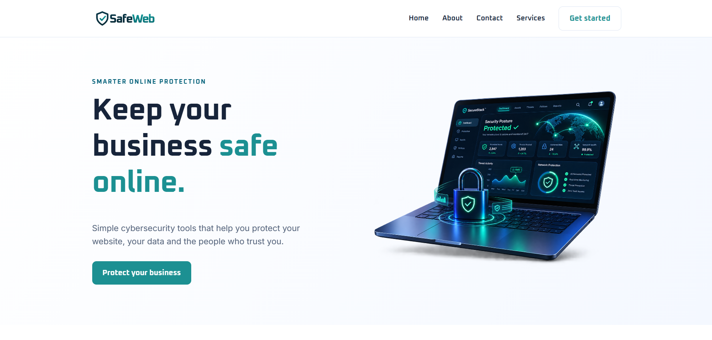

# SafeWeb

A responsive cybersecurity SaaS landing page built with HTML5 and CSS3, without JavaScript.

## Features

- Responsive design using CSS Grid and Flexbox
- CSS design tokens and fluid typography
- CSS-only mobile menu using the checkbox hack (`:checked` selector)
- SVG sprite icons and load-in animations
- Accessibility features and reduced-motion support
- Print-friendly stylesheet

## Screenshot

## Live Demo

[View Website](https://safeweb-landing-page.vercel.app/)
